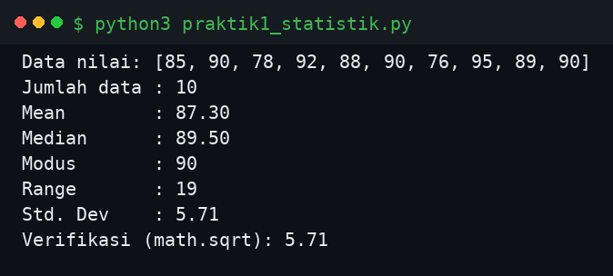
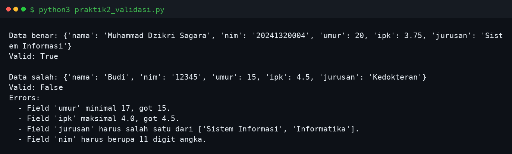
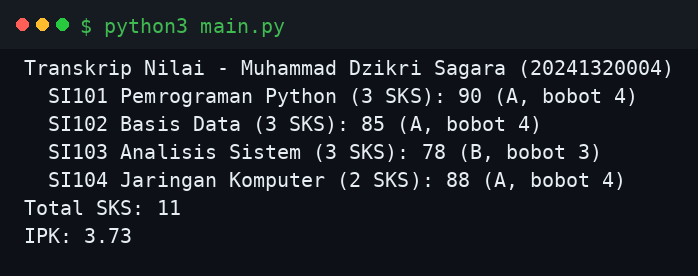
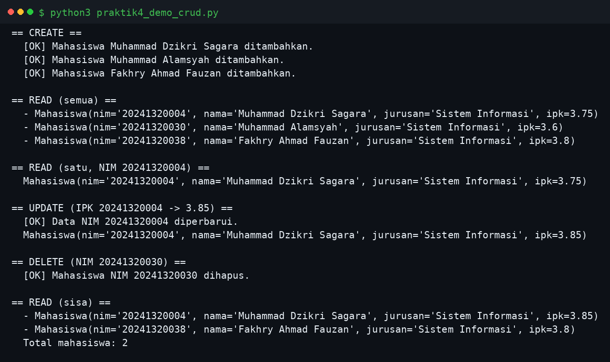
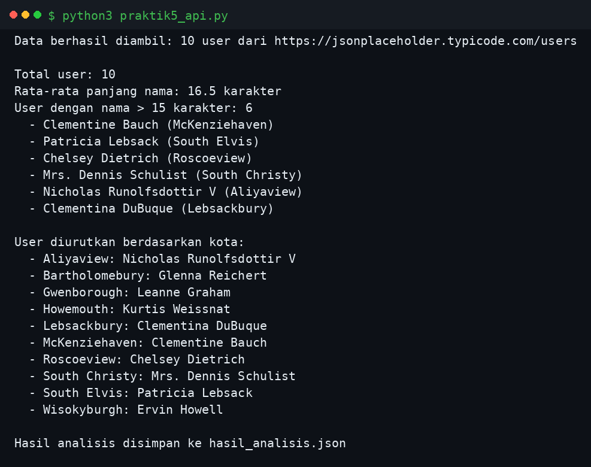

# Python Task 6 — Function, Parameter, Return Value, Scope, Lambda, Module, Package & Library

## Identitas

| | |
|---|---|
| Nama | Muhammad Dzikri Sagara |
| NPM | 20241320004 |
| Program Studi | Sistem Informasi A1 |
| Mata Kuliah | Pemrograman Python — Pertemuan 6 |
| Modul | Modul Bahan Ajar Python: Function, Parameter, Return Value, Scope, Lambda, Module, Package & Library |

## Deskripsi

Repositori ini berisi penyelesaian **Latihan Soal Pertemuan 6** dari modul bahan ajar
Pemrograman Python. Modul ini membahas fungsi dan organisasi kode: definisi fungsi,
jenis-jenis parameter (positional, default, keyword, `*args`, `**kwargs`), return value
(termasuk multiple return dan higher-order function), scope dengan aturan LEGB,
lambda, module, package, dan library (standard library serta third-party lewat pip).

Soal teori dijawab pada [`soal_teori.md`](soal_teori.md), sedangkan lima soal praktik
diimplementasikan sebagai program Python yang semuanya sudah dijalankan dan hasilnya
diverifikasi:

| Soal | Program | Konsep Utama | Ringkasan |
|---|---|---|---|
| Praktik 1 | `praktik1_statistik.py` | Function, return dict, standard library | Mean, median, modus, range, std. dev. dari list angka |
| Praktik 2 | `praktik2_validasi.py` | `*args`, `**kwargs`, return tuple | Validasi dict data terhadap schema (tipe & rentang) |
| Praktik 3 | `utilitas_akademik.py` + `main.py` | Module, `if __name__ == "__main__"` | hitung IPK, konversi huruf, transkrip nilai |
| Praktik 4 | `sistem_informasi/` + `praktik4_demo_crud.py` | Package, subpackage, `__init__.py` | CRUD Mahasiswa (model, service, utils) in-memory |
| Praktik 5 | `praktik5_api.py` | Library `requests`, lambda, `map`/`filter`/`sorted`, `json` | Ambil data JSONPlaceholder, analisis, simpan JSON |

## Cara Menjalankan

```bash
python3 praktik1_statistik.py
python3 praktik2_validasi.py
python3 utilitas_akademik.py   # testing mandiri modul (blok __main__)
python3 main.py                # memakai modul utilitas_akademik
python3 praktik4_demo_crud.py  # demo CRUD package sistem_informasi
python3 praktik5_api.py        # butuh internet + library requests
```

Tidak ada dependensi eksternal kecuali `requests` untuk soal 5
(`pip install requests`).

## Hasil Eksekusi

Screenshot di bawah ini adalah hasil eksekusi program yang sesungguhnya. Output
terminal yang sama juga tersimpan sebagai teks di folder `outputs/`.

### Praktik 1 — Fungsi Statistik



### Praktik 2 — Validasi Data



### Praktik 3 — Modul Utilitas Akademik (via main.py)



### Praktik 4 — Package sistem_informasi (Demo CRUD)



### Praktik 5 — Analisis Data API (JSONPlaceholder)



## Struktur Repositori

```
.
├── README.md
├── soal_teori.md
├── praktik1_statistik.py
├── praktik2_validasi.py
├── utilitas_akademik.py
├── main.py
├── praktik4_demo_crud.py
├── praktik5_api.py
├── hasil_analisis.json
├── sistem_informasi/
│   ├── __init__.py
│   ├── model/
│   │   ├── __init__.py
│   │   └── mahasiswa.py
│   ├── service/
│   │   ├── __init__.py
│   │   └── mahasiswa_service.py
│   └── utils/
│       ├── __init__.py
│       └── validators.py
├── outputs/
│   ├── praktik1.txt
│   ├── praktik2.txt
│   ├── praktik3.txt
│   ├── praktik3_modul.txt
│   ├── praktik4.txt
│   └── praktik5.txt
└── screenshots/
    ├── hasil_praktik1.png
    ├── hasil_praktik2.png
    ├── hasil_praktik3.png
    ├── hasil_praktik4.png
    └── hasil_praktik5.png
```
